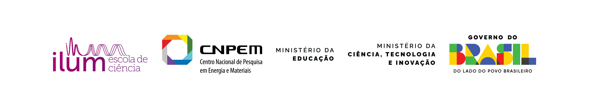

# Tratamento e Análise Quantitativa de Imagens de Microscopia Eletrônica de Varredura (SEM)

<p align="center">
  
</p>

<p align="center">
  <i>Desenvolvimento de ferramentas computacionais em Python para melhorar imagens, corrigir interferências da aquisição, identificar estruturas, analisar características de materiais e estudar a organização de partículas, grãos e poros.</i>
  <br><br>
  Ilum School of Science | Campinas, 2026
</p>

## Sobre o projeto

Este repositório reúne um conjunto de notebooks desenvolvidos em Python para o processamento e a análise quantitativa de imagens obtidas por **Microscopia Eletrônica de Varredura (SEM)**.

O objetivo é desenvolver ferramentas computacionais capazes de melhorar a qualidade das imagens, corrigir possíveis interferências durante sua aquisição, identificar estruturas presentes nos materiais e extrair informações sobre suas características.

O projeto trabalha com imagens convencionais em duas dimensões (2D), incluindo arquivos nos formatos `.tif`, `.png`, `.jpg` e `.bmp`, como a imagem de referência `MEV-NC_AM_BSE_005.tif`.

Os métodos utilizados permitem realizar diferentes tipos de análise diretamente sobre essas imagens, sem exigir conjuntos de dados multidimensionais, como os utilizados em técnicas avançadas de microscopia eletrônica, ou bibliotecas externas complexas.

O processamento está organizado em **dois pipelines complementares**, que trabalham com duas formas de preparação das imagens:

- **SCIENTIFIC:** voltado às análises quantitativas, buscando preservar as informações originais da imagem e evitar alterações que possam interferir nas medições.
- **VISUAL:** voltado à apresentação e observação das imagens, com ajustes de contraste, redução de ruídos e realce de contornos para facilitar a identificação das estruturas.

Essa organização permite utilizar os resultados tanto em análises científicas quanto na produção de imagens para apresentações e documentação.

---

## Estrutura e Pipelines dos Notebooks

### 1. Restauração, Realce e Qualidade de Imagem (`260717_SEM_2`)

Este pipeline é dedicado à melhoria da qualidade das imagens e à correção de problemas que podem surgir durante a aquisição pelo microscópio.

Como as imagens SEM são formadas pela varredura da superfície da amostra com um feixe de elétrons, podem apresentar diferenças de iluminação, linhas indesejadas, ruídos e perda de definição. O pipeline reúne ferramentas para corrigir esses problemas e facilitar a visualização das estruturas.

As principais etapas são:

- **Calibração e identificação da área útil:** identificação automática das informações presentes no rodapé da imagem, como dados do equipamento e barras de escala. Quando disponíveis, os valores de calibração podem ser obtidos diretamente dos metadados do arquivo. Também é possível identificar a barra de escala para estabelecer a relação entre pixels e unidades de comprimento, como nanômetros (`nm/pixel`).

- **Correção de interferências da aquisição:** remoção de linhas horizontais indesejadas, diferenças de brilho entre regiões da imagem e pixels muito claros causados por ruídos ou falhas de aquisição. Também é realizada uma correção da iluminação para reduzir regiões excessivamente claras ou escuras que não representam necessariamente diferenças reais na amostra.

- **Análise de frequências (FFT):** utilização de uma ferramenta matemática que permite identificar padrões e detalhes presentes na imagem de acordo com sua frequência espacial. Isso ajuda a distinguir estruturas maiores, detalhes menores e ruídos, além de permitir a criação de imagens com diferentes faixas de informação.

- **Imagens com diferentes características de contraste (BF e ADF):** aplicação de filtros matemáticos para separar informações da imagem conforme suas frequências. O resultado são diferentes formas de visualização, inspiradas nos modos Bright Field (BF) e Annular Dark Field (ADF), que destacam diferentes características do sinal original.

- **Reconstrução DPC e estimativa de relevo aparente:** análise das variações de intensidade da imagem para construir mapas que representam mudanças locais no sinal. Também é possível gerar uma estimativa visual do relevo da superfície por meio da técnica *Shape-from-Shading*, que interpreta as diferenças de brilho como possíveis variações de inclinação e orientação da superfície.

- **Análise de contraste relativo:** comparação da intensidade de cada região com uma referência, permitindo visualizar áreas que apresentam maior ou menor intensidade em relação ao restante da imagem.

- **Restauração de imagem (Richardson-Lucy):** aplicação de um método matemático que tenta recuperar detalhes que podem ter sido suavizados durante a formação da imagem. O processo simula como o feixe de elétrons e o sistema de aquisição podem espalhar o sinal, buscando produzir uma imagem mais definida sem aumentar excessivamente os ruídos.

- **Avaliação da qualidade da imagem:** cálculo de indicadores que ajudam a comparar diferentes versões da imagem, como a relação entre sinal e ruído (SNR), nitidez, entropia e definição das bordas. Também são realizadas análises de distribuição de intensidade e identificação de diferentes regiões da amostra.

### 2. Segmentação, Detecção, Textura e Orientação (`260716_SEM_2`)

Este pipeline tem como objetivo identificar automaticamente as estruturas presentes nas imagens e realizar uma análise quantitativa de suas características.

Ele pode ser utilizado para estudar diferentes elementos de um material, como partículas, grãos e poros, permitindo selecionar se os objetos de interesse são mais claros ou mais escuros em relação ao fundo.

As principais etapas são:

- **Detecção automática de objetos:** identificação de partículas e outras estruturas com base em seu tamanho e formato. O sistema utiliza filtros matemáticos para localizar objetos semelhantes e estimar suas posições, inclusive quando estão parcialmente próximos uns dos outros.

- **Separação de objetos e análise de tamanho:** identificação individual de estruturas que estão encostadas ou agrupadas. São utilizadas técnicas de segmentação, como Otsu e Watershed, para separar os objetos e determinar seus limites.

- **Caracterização morfológica:** cálculo de informações sobre cada estrutura identificada, incluindo área, diâmetro equivalente, circularidade, proporção entre comprimento e largura e grau de preenchimento. Também são calculados os valores \(D_{10}\), \(D_{50}\) e \(D_{90}\), que representam diferentes pontos da distribuição de tamanhos dos objetos.

- **Análise da distribuição espacial:** estudo da maneira como as partículas estão organizadas na imagem. Essa análise permite investigar se os objetos estão distribuídos aleatoriamente, concentrados em determinadas regiões ou organizados segundo algum padrão.

- **Distância entre partículas:** cálculo das distâncias entre objetos próximos, incluindo a identificação do vizinho mais próximo de cada partícula. Também são utilizadas estruturas matemáticas chamadas diagramas de Voronoi, que dividem a imagem em regiões associadas a cada objeto, permitindo estudar a distribuição espacial.

- **Mapeamento de orientação:** identificação da direção predominante dos objetos. Para isso, cada estrutura segmentada é comparada com modelos matemáticos de elipses de diferentes formatos e inclinações, permitindo estimar sua orientação e proporção entre os eixos.

- **Análise de textura e rugosidade:** estudo das variações de intensidade e dos padrões visuais presentes em diferentes regiões da imagem. São calculadas medidas de rugosidade, entropia e matrizes de coocorrência de níveis de cinza (GLCM), que ajudam a caracterizar a textura dos materiais.

- **Análise de orientação local:** identificação da direção predominante de bordas e estruturas em diferentes regiões da imagem. Os resultados podem ser apresentados em mapas de orientação e gráficos que mostram a distribuição das direções identificadas.

---

## Fluxo Geral de Processamento

O processamento das imagens é organizado em cinco etapas principais:

| Etapa | O que é realizado | Principais resultados |
|---|---|---|
| **1. Calibração e limpeza** | Identificação da área útil, leitura das informações de escala, remoção de linhas indesejadas, correção de pixels defeituosos e uniformização da iluminação. | Imagens `*_PLUS_SCIENTIFIC.tif` e `*_PLUS_VISUAL.tif`. |
| **2. Restauração e análise de relevo** | Separação das informações da imagem por frequência, construção de mapas de contraste, estimativa de relevo e restauração de detalhes. | Imagens `*_RESTAURADA_*.tif`, `*_DPC.tif` e `*_RELEVO_APARENTE.tif`. |
| **3. Identificação e medição de objetos** | Detecção e separação de partículas, grãos e poros, seguida da medição de suas dimensões e características. | Tabela `*_OBJETOS.csv` e imagem `*_ROTULOS.tif`. |
| **4. Análise da distribuição espacial** | Estudo das distâncias entre objetos, concentração de partículas e organização espacial na imagem. | Mapa `*_DENSIDADE_LOCAL.tif` e tabela `*_RESUMO_ANALISES.csv`. |
| **5. Orientação e textura** | Análise do formato, direção, rugosidade e textura das estruturas, além da avaliação da qualidade das imagens. | Arquivos `*_ORIENTACAO_ELIPSES.csv`, `*_ORIENTACAO_LOCAL.tif`, `*_RUGOSIDADE_LOCAL.tif` e `*_METRICAS_QUALIDADE.csv`. |

---

## Tecnologias utilizadas

O projeto utiliza bibliotecas da linguagem Python voltadas ao processamento de imagens, cálculos matemáticos, identificação de estruturas e apresentação de resultados.

| Biblioteca | Aplicação |
|---|---|
| `Python` | Linguagem de programação utilizada para desenvolver os pipelines. |
| `NumPy` | Manipulação de imagens como matrizes de números e realização de cálculos matemáticos. |
| `SciPy` | Aplicação de filtros, operações matemáticas, cálculo de distâncias e análise da distribuição espacial dos objetos. |
| `scikit-image` | Ferramentas para identificação e separação de estruturas, análise de textura, detecção de bordas e restauração de imagens. |
| `tifffile` | Leitura e gravação de imagens TIFF, incluindo o acesso a informações de calibração e metadados disponíveis nos arquivos. |
| `Matplotlib` | Criação de gráficos, mapas de cores, visualização de resultados e representação da orientação das estruturas. |
| `OpenCV (cv2)` | Biblioteca opcional utilizada para acelerar operações de processamento, redução de ruídos e melhoria de contraste. |

---

## Requisitos e instalação

Para executar os notebooks, recomenda-se utilizar **Python 3.10 ou superior**, juntamente com o JupyterLab ou Jupyter Notebook.

As principais bibliotecas utilizadas podem ser instaladas executando o seguinte comando:

```bash
pip install numpy scipy scikit-image tifffile matplotlib opencv-python jupyter
```

Após a instalação, basta iniciar o Jupyter e abrir o notebook desejado para executar as etapas de processamento e análise.

---

## Considerações finais

Os pipelines foram desenvolvidos para facilitar o processamento e a análise de imagens de Microscopia Eletrônica de Varredura, reunindo diferentes ferramentas em etapas organizadas e automatizadas.

Além de melhorar a qualidade visual das micrografias, o projeto permite transformar informações presentes nas imagens em dados quantitativos, possibilitando estudar características como tamanho, formato, orientação, textura e distribuição espacial de partículas, grãos e poros.

Dessa forma, as ferramentas desenvolvidas podem auxiliar na caracterização de materiais, oferecendo recursos para observar estruturas em escala microscópica e investigar suas propriedades morfológicas e espaciais.
